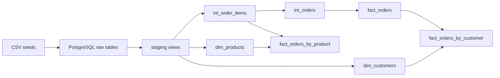

# dbt-starter-analytics

An e-commerce analytics project built with **dbt Core, PostgreSQL 16, and uv**.
It transforms raw customer, product, order, and order-line records into documented
staging views, validated intermediate tables, dimensions, and sales facts.

The fictional CSV inputs deliberately contain duplicate records, invalid dates
and amounts, missing attributes, and unmatched customer/product references. The
project exposes these issues while producing consistent analytics from valid lines.
Docker runs PostgreSQL; Python, uv, and dbt run on your host machine.

## Architecture and layers



This diagram describes physical data flow. In dbt's DAG, `source('ecom', ...)`
references an existing relation, not a seed node. Load seeds before running models.

| Layer/model | Materialization | Grain and purpose |
| --- | --- | --- |
| `seeds/raw/raw_*.csv` | Seed tables in `raw` | Fictional input records, including intentional quality issues. |
| `stg_customers` | View | One output row per source row; normalizes customer attributes and flags missing email/unusable registration dates. |
| `stg_products` | View | One output row per source row; normalizes the catalog, parses prices and active flags, and flags unusable prices. |
| `stg_orders` | View | One output row per source row; parses dates, standardizes status/payment method, and flags unusable dates. |
| `stg_order_items` | View | One output row per source row; parses monetary amounts and flags invalid quantities, prices, and discounts. |
| `int_order_items` | Table | One validated line per `order_item_id`, enriched with a matching order header; calculates gross/net amounts. |
| `int_orders` | Table | One row per `order_id`; totals retained valid lines across all statuses. |
| `dim_customers` | Table | One row per `customer_id`; current attributes and quality flags, including incomplete profiles. |
| `dim_products` | Table | One row per `product_id`; current catalog attributes, including inactive products and invalid catalog prices. |
| `fact_orders` | Table | One row per `order_id`; exposes intermediate order totals and attributes for all statuses. |
| `fact_orders_by_customer` | Table | One row per customer with a retained `COMPLETED` order; order count, units, and net amount. |
| `fact_orders_by_product` | Table | One row per product on a retained `COMPLETED` line; distinct order count, units, and net amount. |

Staging deliberately preserves duplicates. Intermediate models and dimensions
remove rows identical across their selected normalized attributes. Conflicting
versions of the same identifier are not arbitrarily resolved: uniqueness tests
must expose them. Dimensions use natural source identifiers and current attributes,
without historical versions or generated surrogate keys.

Folders define logical layers. By default, all models are created in the profile's
output schema (`analytics` in the example profile), while seeds are loaded into `raw`.

## Business rules

- `gross_revenue = quantity * unit_price`.
- `discount` is the **total line discount**, applied once:
  `net_revenue = gross_revenue - discount`.
- A valid line requires positive quantity and transaction unit price, plus a known
  discount satisfying `0 <= discount < gross_revenue`. Missing discounts are not
  replaced with zero. Fully discounted lines are excluded because net amounts must
  be strictly positive.
- A line must match an order header with a usable date. Unmatched headers and
  orders with invalid dates are excluded from intermediate models.
- Missing customer/product catalog records do not remove otherwise valid lines.
  Aggregate facts use `LEFT JOIN` to dimensions; missing names remain `NULL` and
  relationship tests warn. Null analytical identifiers still fail `not_null` tests.
- Orders with no valid lines are absent from `int_orders` and `fact_orders`.
  Orders with some rejected lines remain, but totals cover **only retained lines**.
  A partially retained order does not mean a partially delivered order.
- `int_order_items`, `int_orders`, and `fact_orders` preserve **all statuses**.
  Only `COMPLETED` contributes to the customer/product sales aggregates.
  `COMPLETE` becomes `COMPLETED`; `SHIPPED`, `PAID`, `REFUNDED`, `CANCELED`, and
  other statuses do not count as completed sales.
- Sales use order status, with no separate delivery event or timestamp. Amounts
  for non-completed orders should not be interpreted as completed sales or
  accounting revenue.
- Transaction prices determine amounts. Catalog prices, product active flags,
  email availability, and registration dates do not exclude valid sales.
- `quantity` counts units, `quantity_order_items` counts retained lines, and
  `quantity_orders` counts orders. Unit prices are not summed at order grain.
- Product order counts are **not additive across products**: one order can contain
  several products. Units and net amounts are additive across product rows.

`parse_money` supports integer amounts, one or two decimal places, US/Brazilian
grouping, optional `$`/`R$` prefixes, and signed values. Missing, malformed,
ambiguous values such as `1,234`/`1.234`, and excessive decimal precision become
`NULL`. Currency prefixes are stripped without currency conversion. See
`macros/parse_money.yml` for the exact accepted formats.

Dates use PostgreSQL's session `DateStyle`; use ISO `YYYY-MM-DD` for unambiguous
input. Email flags check missing values, not email syntax. Unknown product active
tokens default to `FALSE`.

For example, order `1027` has three source lines. Two pass validation; the third
has a discount greater than its gross amount. The fact retains two lines, four
units, and a net amount of `2,587.98`. This is the retained-line total, not a
guarantee of the original order's full value.

## Repository and YAML documentation

```text
dbt_project.yml            Project paths, materializations, seed schema/tags
docker-compose.yaml        PostgreSQL service, persistent volume, health check
profiles.example.yml       Portable connection profile with environment variables
pyproject.toml / uv.lock   Python requirements and locked dependencies
seeds/raw/                Four CSV fixtures and _seeds.yml
models/staging/           Four cleanup views, their YAMLs, and _sources.yml
models/intermediate/      Validated order lines/totals, each with a YAML
models/mart/              Two dimensions and three facts, each with a YAML
macros/                   Money parser, positive-value test, schema naming, YAMLs
tests/                    SQL assertions for calculations and reconciliation
docs/review.md            Review findings and verification of supplied data
```

Each model has a same-named `.yml` file alongside its `.sql` file. It documents
grain, transformations, exclusions, columns, types, and tests. `data_type` entries
describe actual PostgreSQL output types; they do not enable an enforced dbt contract.

| YAML location | Responsibility |
| --- | --- |
| `models/staging/stg_*.yml` | Documents normalization, preserved source rows, and quality flags. Tests require non-null binary flags; unit tests exercise parsing and normalization. |
| `models/intermediate/int_order_items.yml` | Documents retained-line rules and calculations; tests keys, required attributes, positive values, relationships, deduplication, and filtering. |
| `models/intermediate/int_orders.yml` | Documents order grain and partial totals; tests keys, required attributes, and aggregation behavior. |
| `models/mart/dim_*.yml` | Documents natural keys, current/optional attributes, and quality flags; tests uniqueness and preservation behavior. |
| `models/mart/fact_*.yml` | Documents order/aggregate grain, status scope, metrics, additivity, and relationships. Aggregate unit tests cover excluded statuses and unmatched dimensions. |
| `seeds/raw/_seeds.yml` | Describes fixtures and fixes load types: IDs/quantities are integers; raw dates, monetary amounts, flags, and other strings remain text. Empty CSV fields load as `NULL`. |
| `macros/*.yml` | Documents macro arguments, accepted monetary formats, strict positive-value validation, and schema naming. |

### What `_sources.yml` does

`models/staging/_sources.yml` declares the logical source `ecom` and maps its
table names to existing PostgreSQL relations:

| dbt reference | Default relation |
| --- | --- |
| `source('ecom', 'customers')` | `raw.raw_customers` |
| `source('ecom', 'products')` | `raw.raw_products` |
| `source('ecom', 'orders')` | `raw.raw_orders` |
| `source('ecom', 'order_items')` | `raw.raw_order_items` |

It provides source/table/column descriptions, raw types, and quality tests.
`identifier` specifies the physical table name; `schema` uses `raw_schema`,
defaulting to `raw`. Declaring a source does not create/load its table; seeds do that.

`generate_schema_name` uses the exact configured schema for seeds tagged
`raw_input`, ensuring they match source declarations. Other resources retain
dbt's default schema naming convention.

Source tests inspect raw values. Raw email uniqueness, for example, does not
guarantee uniqueness after trimming/lowercasing. Source uniqueness failures
report quality issues without removing staging records. The YAML test syntax uses
[`data_tests` with nested `arguments`](https://docs.getdbt.com/reference/resource-properties/data-tests).

## Run locally

### 1. Install Git and Docker

Install [Git](https://git-scm.com/downloads) and
[Docker Desktop](https://docs.docker.com/get-started/get-docker/). On Windows,
follow the [Docker Desktop installation guide](https://docs.docker.com/desktop/setup/install/windows-install/),
including its WSL 2 requirements, and use Linux containers. Complete any requested
restart and start Docker Desktop. Linux users can alternatively install
[Docker Engine](https://docs.docker.com/engine/install/) and its Compose plugin.

Verify the client, engine, and Compose plugin:

```sh
git --version
docker version
docker compose version
```

### 2. Install uv and Python

Use the [official uv installer](https://docs.astral.sh/uv/getting-started/installation/).
On Windows PowerShell:

```powershell
powershell -ExecutionPolicy ByPass -c "irm https://astral.sh/uv/install.ps1 | iex"
```

On macOS/Linux:

```sh
curl -LsSf https://astral.sh/uv/install.sh | sh
```

Open a new terminal if necessary, then install the Python version declared in
`.python-version`:

```sh
uv --version
uv python install 3.13
```

### 3. Clone and install dependencies

```sh
git clone https://github.com/carlosmichelutti/dbt-starter-analytics.git
cd dbt-starter-analytics
uv sync --locked
uv run dbt --version
```

This creates `.venv` and installs versions from `uv.lock`. The project uses dbt
Core v1 and `dbt-postgres`. No environment activation or `dbt deps` step is needed;
there are no external dbt packages or application-specific Python commands.

### 4. Start PostgreSQL

From the repository root:

```sh
docker compose up -d --wait
docker compose ps
```

Compose uses `postgres:16`, a health check, and the persistent `postgres_data` volume.

| Setting | Default |
| --- | --- |
| Host | `localhost` |
| Host port | `5432` |
| Database | `dbt-starter-analytics` |
| User | `postgres` |
| Password | `postgres1234` |
| dbt output schema | `analytics` (example profile) |
| Input schema | `raw` |

The password is a local demo default. Keep personal credentials in environment
variables or your local profile, outside version control.

If port `5432` is occupied, choose another host port **in the same terminal used
for Compose and dbt**. In PowerShell:

```powershell
$env:DATABASE_PORT = "5433"
docker compose up -d --wait
```

On macOS/Linux, use `export DATABASE_PORT=5433`. The container port remains `5432`.

### 5. Configure the dbt profile

Copy `profiles.example.yml` to `~/.dbt/profiles.yml`. If that file already exists,
merge the `dbt_starter_analytics` entry into it to preserve your other profiles.

Windows PowerShell, for a new profile file:

```powershell
New-Item -ItemType Directory -Force "$HOME/.dbt"
Copy-Item profiles.example.yml "$HOME/.dbt/profiles.yml"
```

macOS/Linux, for a new profile file:

```sh
mkdir -p ~/.dbt
cp profiles.example.yml ~/.dbt/profiles.yml
```

The profile reads `DATABASE_HOST`, `DATABASE_PORT`, `DATABASE_NAME`,
`DATABASE_USER`, and `DATABASE_PASSWORD`, falling back to the Compose defaults.
`DBT_SCHEMA` controls the model schema and defaults to `analytics`. The profile
name must match `profile: dbt_starter_analytics` in `dbt_project.yml`.

Compose also reads a local `.env` file, but dbt does not automatically load it.
If you use one, run dbt with `uv run --env-file .env dbt ...` to pass those values.
PostgreSQL initialization variables apply when its volume is first initialized;
changing them later does not change existing database roles/passwords.

```sh
uv run dbt debug
```

### 6. Load seeds, run models, and test

Run these commands in order:

```sh
uv run dbt seed
uv run dbt run
uv run dbt test
```

`seed` creates/loads the four raw tables; no manual DDL or `COPY` is required.
`run` builds all staging, intermediate, and mart models. `test` runs generic data
tests, SQL assertions, source checks, and YAML unit tests.

**The supplied fixtures produce three source-test failures and five relationship
warnings**, detailed below. Use the separate commands above so source failures do
not prevent reviewing the built analytical models. An unrestricted `dbt build`
also runs source tests; these failures can skip downstream models/tests.

After changing seed column types or structure, reload the demo tables:

```sh
uv run dbt seed --full-refresh
uv run dbt run
```

To isolate input data, use the same variable in all relevant commands:

```sh
uv run dbt seed --vars 'raw_schema: raw_demo'
uv run dbt run --vars 'raw_schema: raw_demo'
uv run dbt test --vars 'raw_schema: raw_demo'
```

This changes input relations only. Set `DBT_SCHEMA` or configure another target
to isolate outputs too. Use distinct input and output schemas for each environment.

### 7. Explore documentation and stop services

```sh
uv run dbt docs generate
uv run dbt docs serve
```

Open [the local dbt documentation](http://localhost:8080) for descriptions, columns,
tests, and lineage. Stop the documentation server with `Ctrl+C`.

```sh
docker compose stop
```

`docker compose down` removes the container/network and retains the database
volume. Restart with `docker compose up -d --wait`. Adding `-v` to `down` deletes
persisted data and is not part of the normal workflow.

## Tests and expected quality findings

The suite checks analytical keys, required fields, relationships, binary flags,
positive values, parsing, arithmetic, catalog preservation, and reconciliation.

| SQL assertion | Checks |
| --- | --- |
| `assert_parse_money.sql` | Accepted formats/signs, missing values, ambiguous separators, malformed grouping, unsupported numeric strings. |
| `assert_valid_order_line_amounts.sql` | Valid line quantities/prices/discounts and gross/net arithmetic. |
| `assert_valid_order_totals.sql` | Positive order totals, nonnegative discounts, and net arithmetic. |
| `assert_catalog_products_remain_linked.sql` | Products present in staging remain available in the dimension for retained lines. |
| `assert_sales_totals_reconcile.sql` | Global intermediate/fact totals and aggregate sales against `COMPLETED` lines. |
| `assert_model_grains_reconcile.sql` | Complete rows in both directions for dimensions, intermediate order totals, the order fact, and customer/product aggregates. Detects missing/extra rows, duplicates, changed attributes, and per-entity differences hidden by global sums. |

YAML unit tests cover parsing/date/status normalization, deduplication, valid line
selection, optional attributes, missing dimensions, aggregation, and the
`COMPLETED` filter. `positive_value` rejects `NULL`, zero, and negatives; discounts
may be zero and use separate arithmetic checks.

With the supplied CSVs, a full `dbt test` deliberately reports these findings:

| Finding | Result | Interpretation |
| --- | --- | --- |
| Source `customers.email` uniqueness | 3 duplicate email groups | Different customer records share raw emails; preserved and reported. |
| Source `orders.order_id` uniqueness | 2 duplicated identifiers | Exact repeated headers; removed before the intermediate join. |
| Source `order_items.order_item_id` uniqueness | 3 duplicated identifiers | Exact repeated lines; removed before the intermediate join. |
| Customer/product relationships | 5 warning tests | Valid transactions reference missing dimension records; amounts are retained. |

Source uniqueness rules have not been weakened to hide duplicate fixtures.
Duplicate emails are a separate source issue, not duplicate analytical customer
keys. Staging preserves the input rows as designed.

Run source checks separately:

```sh
uv run dbt test --select "source:ecom.*"
```

Validate analytical models, SQL assertions, and unit tests without source tests:

```sh
uv run dbt test --exclude "source:ecom.*"
```

Run only unit tests or reconciliation assertions:

```sh
uv run dbt test --select "test_type:unit"
uv run dbt test --select assert_sales_totals_reconcile assert_model_grains_reconcile
```

The analytical selection passes with five warnings on the supplied data. It does
not replace source validation. See [docs/review.md](docs/review.md) for the review
results and reconciled values.
